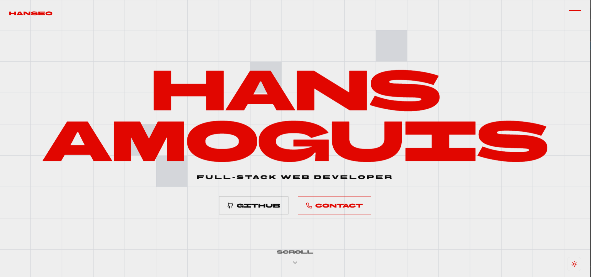

# Hans Amoguis — Full-Stack & AI Product Engineer

I design and build production-minded full-stack web systems and AI-enabled products with Next.js, React, TypeScript, LangChain, and FastAPI.

🔗 **Live Site:** https://hanseo.tech  
💼 **LinkedIn:** https://linkedin.com/in/hanseooo  
🐙 **GitHub:** https://github.com/Hanseooo

---

## Overview & Narrative Architecture

This portfolio is built around **"Constructed Signal"**, an editorial visual language and a 6-stage **Evidence Ladder** narrative structure designed to present engineering capabilities through verified proof, system metrics, and technical artifacts.

### Key Highlights
- **Evidence-Based Storytelling:** Native vertical document flow structured into distinct chapters (01 Identity, 02 Selected Work, 03 Capabilities, 04 Experience, 05 Presence, 06 Contact).
- **Constructed Signal Visual Grammar:** High-contrast editorial layout with exposed structural grids, documentary artifact frames, and non-wrapping metadata badges.
- **Dual-Theme Aesthetic System:** 
  - **Light Mode (Default):** Warm Ivory foundation (`#F3F0E9`) with Signal Red (`#E10600`) accent.
  - **Dark Mode:** Deep True Black foundation (`#080909`) with Ice Blue (`#00E5FF`) accent.
- **5-Tier Motion Capability Policy (`lib/capability-policy.ts`):** Central runtime authority that dynamically scales animation budgets across 5 tiers (`reduced-motion`, `webview-constrained`, `mobile-touch`, `short-height`, and `full-desktop`).
- **Live Activity Integration:** Real-time presence widgets powered by Next.js Route Handlers fetching live GitHub activity, Spotify now-playing & top tracks, and Discord status via Lanyard API with background revalidation.

---

## Tech Stack

### Core Framework & Runtime
- **Framework:** Next.js 16 (App Router, Server Components, Route Handlers, Dynamic OpenGraph Image Generation)
- **UI Engine:** React 19 & React DOM 19
- **Language:** TypeScript 5 (Strict type safety across API routes, content projections, and components)
- **Styling:** Tailwind CSS v4 (`@tailwindcss/postcss`) with CSS Custom Properties (`app/globals.css`)
- **UI Primitives:** Radix UI (`dialog`, `tooltip`, `slot`) + Lucide Icons

### Animation & Motion Architecture
- **GSAP 3 + ScrollTrigger:** Desktop depth effects and compositor-unblocked parallax
- **Framer Motion 12:** Structured text reveals, presence animations, and route handoff overlays
- **Lenis 1.3:** Desktop smooth scrolling with capability-gated runtime policy
- **@use-gesture/react:** Touch and pointer gesture utilities

---

## Route & Directory Structure

```text
app/
├── page.tsx                       # Homepage (6-Stage Evidence Ladder + Tech Matrix)
├── projects/
│   ├── page.tsx                   # Project Index Catalogue
│   └── [slug]/
│       ├── page.tsx               # Deep-dive Project Case Study
│       └── opengraph-image.tsx    # Dynamic OpenGraph share image
├── experience/
│   ├── page.tsx                   # Comprehensive Career Ledger
│   └── opengraph-image.tsx
├── certificates/
│   ├── page.tsx                   # Documentary Certificate Register
│   └── [slug]/
│       ├── page.tsx               # Certificate Detail View
│       └── opengraph-image.tsx
└── api/
    └── activity/                  # Live Activity API Route Handlers
        ├── github/route.ts        # GitHub GraphQL commits & activity
        ├── spotify/route.ts       # Spotify OAuth now-playing & top tracks
        └── discord/route.ts       # Discord Lanyard presence
```

### Components Layout (`components/`)
- `components/homepage/`: Scene components (`SceneIdentity`, `SceneFlagships`, `SceneExperience`, `ScenePresence`, `SceneContact`, `HomepageChapterNav`)
- `components/shell/`: Global layout frame (`PortfolioFrame`, `GlobalNav`, `MobileMenu`, `FooterFrame`, `ThemeControl`, `RouteHandoffOverlay`)
- `components/routes/`: Route record templates (`ProjectCatalogueRecord`, `ProjectEvidenceBody`, `ExperienceCareerRecord`, `CertificateRegisterRecord`)
- `components/evidence/`: Structural documentary widgets (`DocumentaryArtifact`, `ProofFigure`, `ScreenshotFrame`, `LiveProviderRegion`)
- `components/motion/`: Motion controllers (`BrandedArrival`, `RouteHandoffController`, `ScrollEnhancementController`, `StructuredReveal`, `SplitText`)
- `components/providers/`: Context providers (`CapabilityProvider`, `PortfolioProviders`, `ThemeProvider`)
- `components/sections/`: `TechStackSection` & Live Activity widgets (`GitHubActivityCard`, `SpotifyActivityCard`, `DiscordActivityCard`)

---

## Getting Started

### Prerequisites
- Node.js 20+
- `pnpm` package manager

### Installation & Development Commands

```bash
# Install dependencies
pnpm install

# Start development server
pnpm dev

# Build for production & typecheck
pnpm build

# Run ESLint check
pnpm lint
```

---

## Environment Variables

Copy `.env.example` to `.env.local` and set your credentials:

```bash
# Public Canonical URL
NEXT_PUBLIC_SITE_URL=https://hanseo.tech

# GitHub Activity Integration
GITHUB_TOKEN=your_github_personal_access_token
GITHUB_USERNAME=your_github_username

# Spotify Integration (OAuth Refresh Token Flow)
SPOTIFY_CLIENT_ID=your_spotify_client_id
SPOTIFY_CLIENT_SECRET=your_spotify_client_secret
SPOTIFY_REFRESH_TOKEN=your_spotify_refresh_token

# Discord Integration (Lanyard API)
DISCORD_USER_ID=your_discord_user_id

# Activity ISR Revalidation Tuning (Seconds)
ACTIVITY_SPOTIFY_REVALIDATE_SECONDS=20
ACTIVITY_SPOTIFY_DETAILS_REVALIDATE_SECONDS=600
ACTIVITY_SPOTIFY_TOP_REVALIDATE_SECONDS=21600
ACTIVITY_DISCORD_REVALIDATE_SECONDS=20
```
